# ⚔️ PixelQuest v1.7.2 — Level Up Your Life

[](https://github.com/RAZAAli901/PixelQuest/releases/latest/download/app-release.apk)
[](https://github.com/RAZAAli901/PixelQuest/releases)
[](https://github.com/RAZAAli901/PixelQuest/releases/tag/v1.7.2)
[](LICENSE)

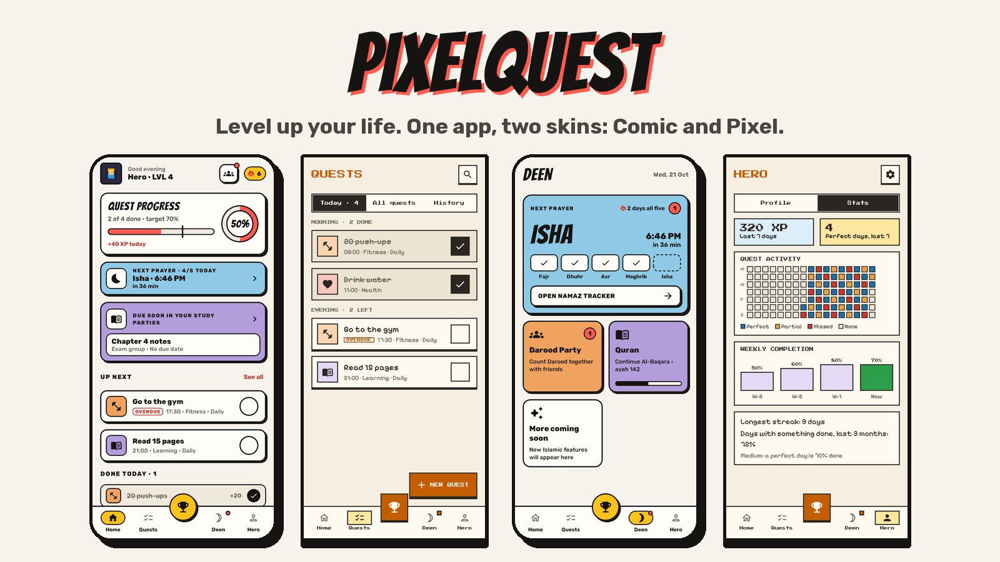

**PixelQuest** is a gamified daily task and habit tracker Android application built with **Kotlin** and **Jetpack Compose**. It turns real-world daily routines into RPG quests, in two skins: **Comic** (the default) and **Pixel**.

---

## ⚡ Direct Download

Click the button below to download the latest signed release APK onto your Android device:

👉 **[📥 Direct Download app-release.apk (v1.7.2)](https://github.com/RAZAAli901/PixelQuest/releases/download/v1.7.2/app-release.apk)** 👈

Or see the release notes and files on the **[📦 v1.7.2 release page](https://github.com/RAZAAli901/PixelQuest/releases/tag/v1.7.2)**.

> **Upgrading from 1.7.x, 1.6.0 or 1.5.0?** Install v1.7.2 over it: everything is kept. (From 1.5.0, a Clean Light or Follow System choice opens in Comic.)
>
> **Upgrading from 1.4.1, 1.4.0, 1.3.0 or 1.2.0?** Install v1.7.2 over it: everything is kept, and the Quran loads once in the background.
>
> **On Android 7.0 or 7.1?** PixelQuest needs Android 7.0 or later. Versions before 1.4.1 closed as soon as they opened on 7.x. 1.4.1 and later run.
>
> **Upgrading from 1.1.0?** From 1.2.0 on, PixelQuest is signed with a new, permanent key, so Android won't install it over 1.1.0. In the old app, open Settings → **EXPORT QUEST DATA** and save the file. Then uninstall it, install v1.7.2, and tap **I have a backup** on the welcome screen. Details: [docs/UPDATES_AND_BACKUPS.md](docs/UPDATES_AND_BACKUPS.md).

---

## ♟️ New in 1.7.0: study chat, the Darood weekly ranking, and chess

- **Study parties** get a chat with files, and reminders for the party or just you.
- **Chess** in study parties: challenge a mate to a 1 to 10 minute game, refereed by the server, rated in Int points, with a ladder and watching live games.
- **Darood Party** ranks each week and tells everyone their place, and goals can be extended once they're reached.
- **Export my cloud data**, and reporting and blocking across chat and chess.
- **Animations** (1.7.2): quests, XP, streaks, the bottom bar and chess move, in each skin's style. Reduce motion turns them off.

Everything new: [CHANGELOG.md](CHANGELOG.md).

---

## 🎨 New in 1.6.0: a new look, and smoother

- **A bottom bar** replaces the side menu: Home, Quests, the trophy (the Leaderboard), Deen and Hero.
- **Two skins**, Comic (the default) and Pixel. Pick one in Settings > Look; Settings opens from the gear on Hero.
- **Every screen is rebuilt** from one set of components, so one setting re-skins the whole app.
- **The Light theme is retired**, and so is Follow System. A phone that used either one opens in Comic.
- **Smoother and quicker:** a faster start, tab switches that don't reload, no refresh circle when you open a party, and a smaller app (4.6 MB).

What moved where, and the building blocks: [docs/ui-v2.md](docs/ui-v2.md). Everything new: [CHANGELOG.md](CHANGELOG.md).

---

## 📥 Download & Installation Guide

### Option 1: Direct Download (Recommended)
1. Open this repository on your Android phone or tablet.
2. Tap **[Download app-release.apk (v1.7.2)](https://github.com/RAZAAli901/PixelQuest/releases/download/v1.7.2/app-release.apk)** to download the file directly.
3. Open your device's **Downloads** folder and tap `app-release.apk`.
4. If prompted, select **Allow from this source** to allow installing unknown apps. On Android 7, turn on **Unknown sources** in Settings > Security instead.
5. Tap **Install**, open **PixelQuest**, and begin your journey!

### Option 2: Via GitHub Releases Page
1. Visit the **[PixelQuest v1.7.2 release](https://github.com/RAZAAli901/PixelQuest/releases/tag/v1.7.2)** page.
2. Under **Assets**, click on **`app-release.apk`**.
3. Install and launch the application on your Android device.

---

## 🎮 Concept & Core Features

- **Gamified Quest Tracking**: Earn XP for every quest, keep a streak of perfect days, and level up. Levels come from perfect days, at your difficulty's pace. Your rank shows as a Bronze, Silver or Gold chip on Hero.
- **A Bottom Bar**: Home, Quests, the trophy (the Leaderboard), Deen and Hero. Settings and your account (Cloud & leaderboard) open from the gear on Hero.
- **Two Skins**: **Comic** (the default: ink borders, rounded corners, hard shadows, Bangers titles) and **Pixel** (square corners, step shadows, Press Start 2P titles). Pick one in Settings > Look. It changes every screen.
- **Home**: today's progress ring, the quests up next, the next prayer, what's due in your study parties, and the Coach card. Its groups button opens Parties.
- **Quests**: Today, All quests and History tabs. Each quest has its own stats: times done, done rate, streaks and the last 14 days.
- **Hero**: two parts.
  - **Profile**: your avatar, level, XP and streak, with Change avatar, Difficulty, Quest history, Level history, Parties and Leaderboard.
  - **Stats**: XP and perfect days over the last 7 days, a 17-week activity heatmap, a four-week completion chart, your longest streak, and Namaz totals.
- **Global Leaderboard**: Sign in with Google to join the opt-in leaderboard under a public name, and keep your progress synced to your account. The trophy opens it.
- **Deen** (the Islamic section, new in 1.5.0, a tab since 1.6.0): the next prayer with its countdown and today's five, the Quran from where you stopped, and Darood Party. Settings > Islamic > **Show the Islamic section** hides the tab and Home's Namaz card; the same card sets the Quran's reading defaults and the reminders. See [docs/islamic-hub.md](docs/islamic-hub.md).
- **Namaz Tracker** (new in 1.3.0, optional): the five daily prayers, with their times worked out on the phone (offline), a reminder as each one starts, and a streak of days with all five.
  - Marking a prayer adds XP to the game's own: 10 a prayer, or 5 if late, and +30 for all five. At most 80 a day, plus +100 for each 7 days in a row.
  - Off until you turn it on. Your place and prayer log stay on the phone. See [docs/namaz-design.md](docs/namaz-design.md).
- **Darood Party** (new in 1.4.0, for signed-in players): small groups count Darood together, in a chat that takes only numbers.
  - Invite friends by username. Each number shows at once and arrives live for everyone. A leader can set a milestone to reach together.
  - My stats shows your total, share, place and how steady you are. An opt-in race board ranks parties by progress, showing names and progress only.
  - **Weekly ranking** (new in 1.7.0): each week, Monday to Sunday in the party's time zone, ranks the members. Everyone gets their place on Sunday night, and the party keeps its past weeks. A goal that's reached can be extended, and the party keeps its goal history. See [docs/darood-weekly.md](docs/darood-weekly.md).
  - It never adds XP or touches the leaderboard. See [docs/darood-design.md](docs/darood-design.md).
- **The Quran** (new in 1.5.0, offline): the Uthmani Arabic from the Tanzil Project and the Saheeh International translation, bundled unchanged and checked on every build. Search, juz, bookmarks, copy and share, text size, a sepia page, and carrying on where you stopped. See [docs/quran-data.md](docs/quran-data.md).
- **Study parties** (new in 1.5.0, for signed-in players): friends pin assignments and quizzes, tick them off, log study time and race on a weekly scoreboard, with reminders before things are due. Their points never touch XP. See [docs/study-party.md](docs/study-party.md).
  - **Reminders** (new in 1.7.0): for the party or just you, once, daily or weekly, with alerts before they're due. See [docs/study-reminders.md](docs/study-reminders.md).
  - **Chat and files** (new in 1.7.0): a chat for each party, live, with replies, and files up to 20 MB (PDFs, images, documents) that are checked before anyone can open them. Report or block from any message. See [docs/study-chat.md](docs/study-chat.md).
- **Chess** (new in 1.7.0, in study parties): challenge a party mate to a 1, 3, 5 or 10 minute game, or open a challenge to the room.
  - The server referees every move and keeps the clocks, so a changed app can't cheat. Games are rated in Int points, with tiers from Pawn to King, a party ladder and your record against each mate.
  - Party mates can watch live games. A challenge arrives as a notification (from 1.7.1) and in the chat.
  - Like the rest of a study party, it never touches XP, levels or streaks. See [docs/chess-design.md](docs/chess-design.md).
- **Parties**: one screen lists your Darood and study parties, and any invitations. New party asks which kind first. It opens from Home's groups button, Deen's Darood Party tile, and Hero > Profile > Parties. See [docs/party-core.md](docs/party-core.md).
- **AI Habit Coach**: Optional short debriefs and suggestions from Google Gemini, for signed-in players, in the Coach card on Home. Task names never leave the phone.
- **Simple Mode**: A calm, un-gamified checklist whenever you want one. It hides XP, levels and streaks, and Quests becomes Tasks.
- **8-Bit Sound Effects**: button clicks, quest completion, missed alerts and level-up fanfares, played with `SoundPool`. Settings has a Sound effects switch, next to Haptics and Reduce motion.
- **Character Avatars**: Choose from 6 retro class sprites (*Hero, Mage, Rogue, Warrior, Paladin, Ranger*).
- **Retro CRT Scanline Filter**: Optional scanlines and vignette for the Pixel skin. Off by default, and never in Simple Mode.
- **Notifications**: drawn to match the app: the PixelQuest mark, your skin's colour, and a comic card when a streak is at risk. Quest reminders ask if you did it, or snooze. Prayer reminders have a Prayed button.
- **App Icon**: an adaptive icon, the Sword Badge, with a themed (monochrome) layer.
- **Backups That Keep Your Progress**: Export to a file, restore it on a new phone from the welcome screen, undo a restore, and daily automatic backups kept on the phone. Updates keep everything from every earlier version.

---

## 📸 Visual Showcase

Each is one of the app's own screens, drawn from its code with sample data.

### One app, two skins

| Skin | Home | Quests | Deen | Hero |
|:----:|:----:|:------:|:----:|:----:|
| **Comic** | 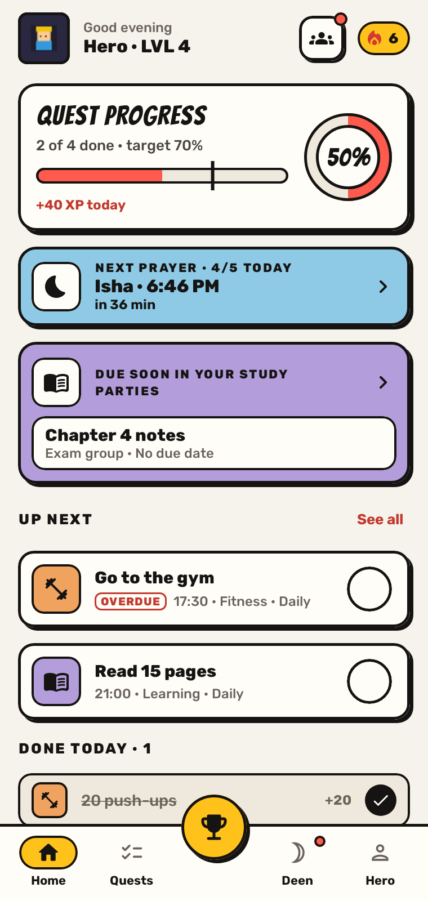 | 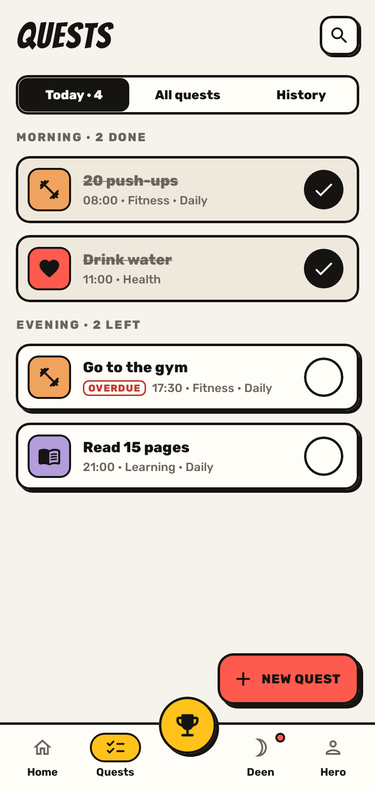 | 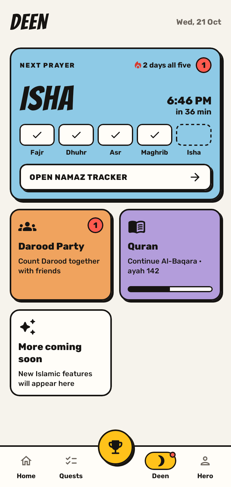 | 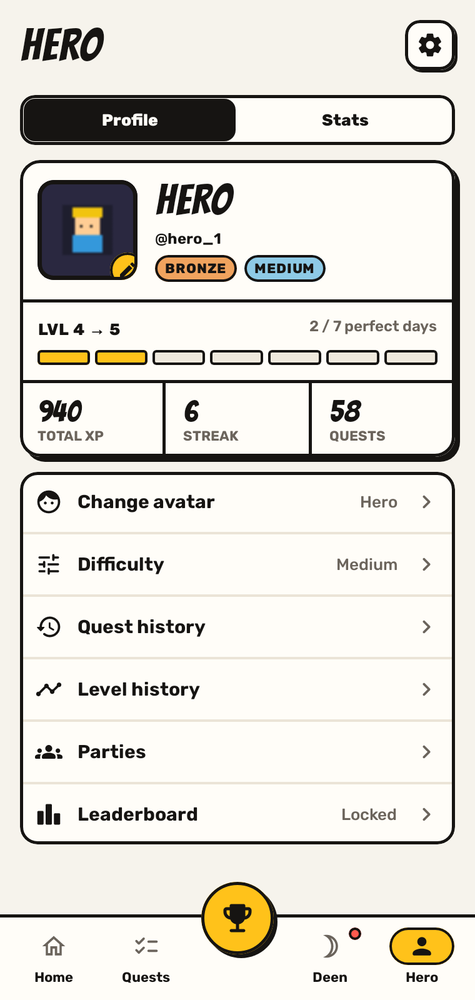 |
| **Pixel** | 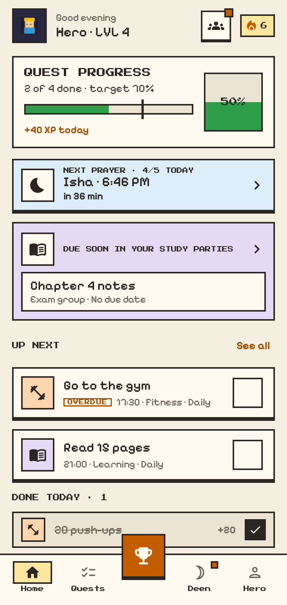 | 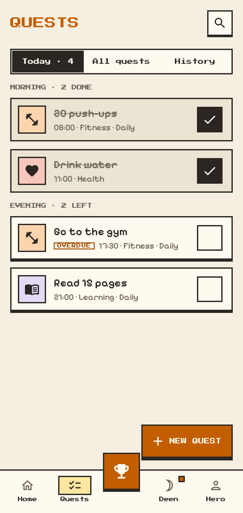 | 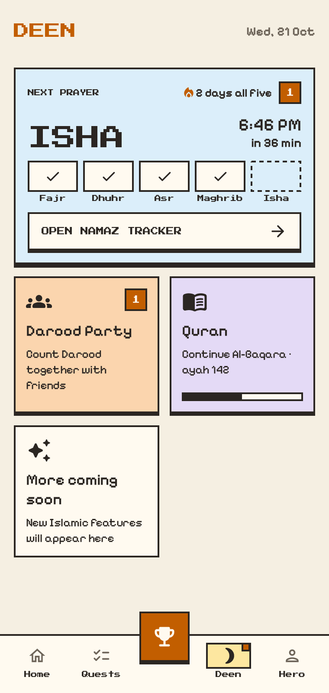 | 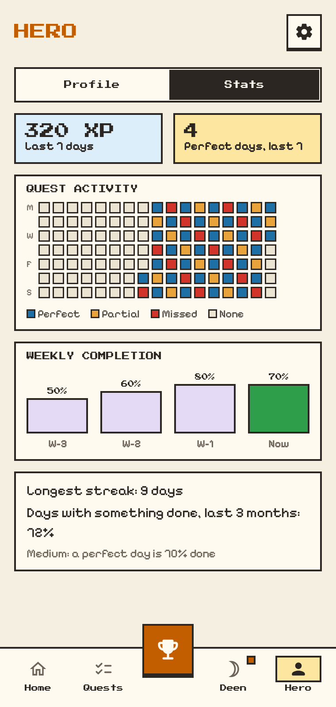 |

### More screens

| The Quran | Parties | AI Coach | Settings |
|:---------:|:-------:|:--------:|:--------:|
| 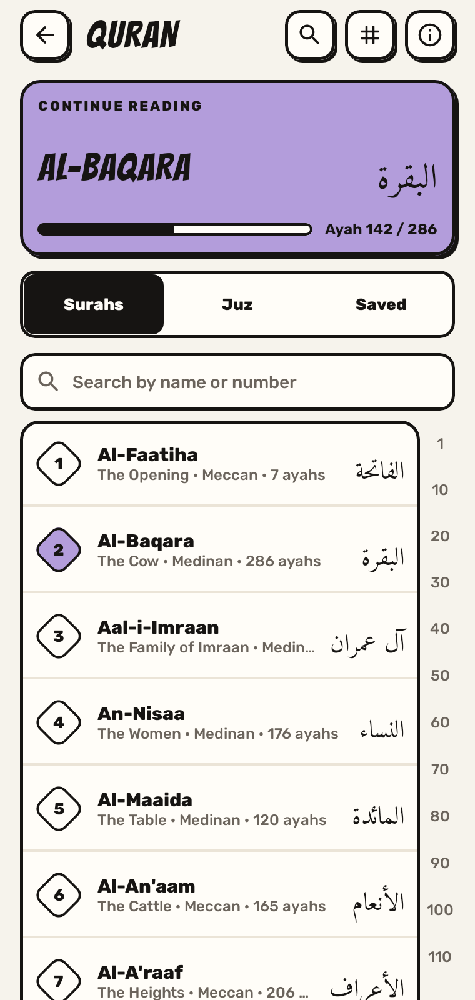 | 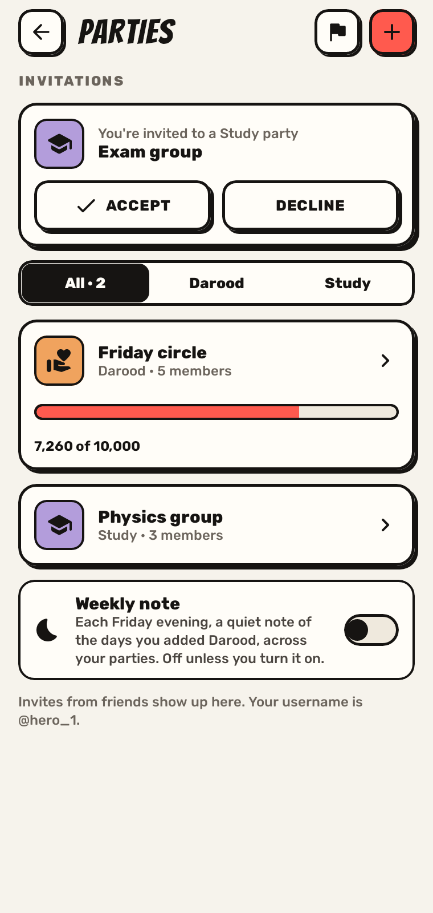 | 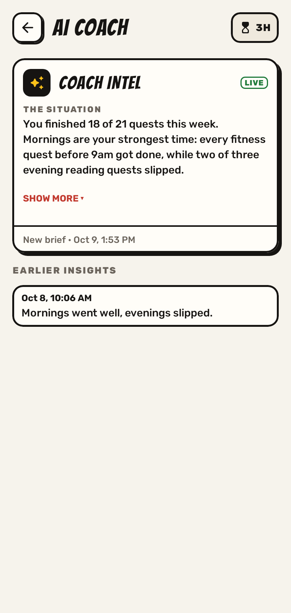 | 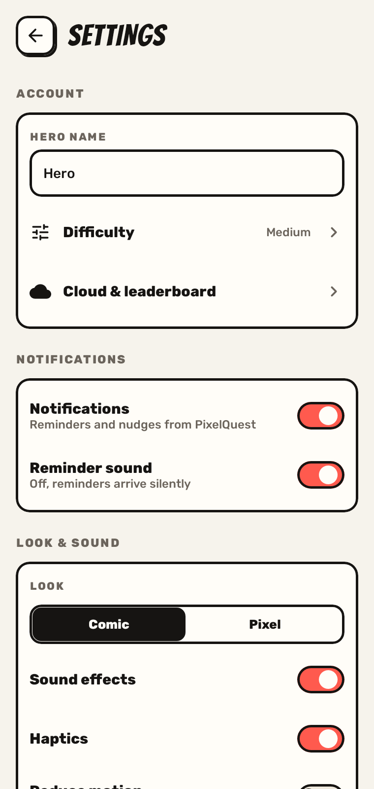 |

The Namaz Tracker's own screenshots are still to be captured. The list is in [docs/namaz-design.md](docs/namaz-design.md#screenshots).

---

## 🛠 Tech Stack & Architecture

- **Language**: Kotlin 2.0.20 (Android SDK 34, Min SDK 24)
- **UI Framework**: Jetpack Compose, with Material 3 underneath. One component set (`PqCard`, `PqButton`, `PqSegmented` and the rest) draws only with the `PqTheme` tokens, in two skins, Comic and Pixel ([docs/ui-v2.md](docs/ui-v2.md))
- **Fonts**: Bangers and Rubik (Comic), Press Start 2P and Pixelify Sans (Pixel), and Amiri Quran for the Quran's Arabic
- **Architecture**: MVVM + Clean Architecture + Reactive Kotlin Flows
- **Database & DI**: Room Database 2.6.1 + Dagger Hilt 2.51
- **Background Tasks**: WorkManager 2.9.0 + AlarmManager Exact Alarms
- **Prayer Times**: [Adhan](https://github.com/batoulapps/adhan-kotlin) 0.0.5, calculated on the phone
- **Cloud**: Supabase (Auth with email-code and Google sign-in, Postgres with row-level security, Realtime for parties' live updates, an Edge Function for the AI Coach)
- **The Quran's data**: built from the Tanzil Project's files by `tools/quran-build`, which checks them byte for byte ([docs/quran-data.md](docs/quran-data.md))
- **CI/CD**: GitHub Actions. Every push to main runs the tests, lint and a release build with an 8 MB size budget. A version tag builds the signed release APK and publishes a GitHub Release.

---

## 🔨 Build from Source

You need JDK 17 and the Android SDK 34.

```bash
# Clone repository
git clone https://github.com/RAZAAli901/PixelQuest.git
cd PixelQuest

# On Linux or macOS, make the wrapper runnable once (on Windows, use gradlew.bat)
chmod +x gradlew

# Build debug APK
./gradlew assembleDebug

# Build release APK
./gradlew assembleRelease
```
The release APK will be generated at:
`app/build/outputs/apk/release/app-release.apk`

The debug APK is at `app/build/outputs/apk/debug/app-debug.apk`.

Without your own signing key (below), a build is signed with the debug key, so Android won't install it over the GitHub release. Export your quest data first, uninstall, install your build, and tap **I have a backup** on the welcome screen.

### Optional settings (`local.properties`, never committed)

To set up sign-in, the leaderboard and the AI Coach from scratch (Supabase project, email and Google sign-in, the AI server, GitHub secrets), follow [docs/CLOUD_SETUP.md](docs/CLOUD_SETUP.md). The Supabase, Google, email sign-in and Gemini settings can also be set for one build with a `PIXELQUEST_<NAME>` environment variable (for example `PIXELQUEST_SUPABASE_URL`); the signing settings use their plain names.

| Setting | Used for |
| --- | --- |
| `SUPABASE_URL`, `SUPABASE_ANON_KEY` | Sign-in (by email code, and Google), cloud sync, the leaderboard, Darood and study parties, and the AI Coach, which is for signed-in players. Without them the app is fully playable offline. |
| `GOOGLE_WEB_CLIENT_ID` | The Sign in with Google button (the Web client ID). Without it, players sign in by email. |
| `EMAIL_SIGN_IN` | `false` hides email-code sign-in, for a project whose emails reach only its own team. On by default; release builds from the release workflow turn it on only when the repository variable `EMAIL_SIGN_IN` is `true` ([docs/CLOUD_SETUP.md](docs/CLOUD_SETUP.md), step 3). |
| `GEMINI_API_KEY` | The AI Coach in **debug** builds only (still only while signed in). Release builds never contain it; they reach Gemini through the `gemini-proxy` Supabase Edge Function, which holds the key ([docs/GEMINI_PROXY.md](docs/GEMINI_PROXY.md)). Add `GEMINI_VIA_PROXY=true` to make a debug build use the proxy too. |
| `KEYSTORE_FILE`, `KEYSTORE_PASSWORD`, `KEY_ALIAS`, `KEY_PASSWORD` | Signing release builds with your own key (or set them as environment variables). Without them, release builds are signed with the debug key. |

### Tests

```bash
./gradlew testDebugUnitTest
```

```bash
node --test "supabase/functions/**/*.test.ts"
```

```bash
./gradlew :tools:quran-build:test
```

CI runs all three on every push to main; the last checks the bundled Quran against Tanzil's files. The Edge Function tests need Node 22.18 or later. Unit tests never call the live Gemini API; `GeminiConnectivitySmokeTest` makes a live call only when `PIXELQUEST_LIVE_GEMINI=1` is set.

The cloud side (database rules, email sign-in, the AI server and the app's repositories) is tested against a Supabase stack running locally in Docker: see [docs/LOCAL_SUPABASE.md](docs/LOCAL_SUPABASE.md). CI runs those tests too (`cloud-tests.yml`). The main CI build also compiles the instrumented tests (`assembleDebugAndroidTest`); running them needs a device or emulator:

```bash
./gradlew connectedDebugAndroidTest
```

---

## 🛡️ Verification Status

- **Unit tests**: 1,800+ Android unit tests on every push to main (1,826 at the last count, none failing). The 19 that need the local Supabase stack are skipped there and run in the cloud tests. The Edge Function and Quran-data tests run too, and the cloud side (database rules, sign-in, the AI server, Darood and study parties) is tested against a local Supabase stack in CI.
- **1.6.0**: the full unit suite, lint and the release build pass in CI. The release APK is 4.6 MB, under its 8 MB budget. On the Android 7.0 emulator it installed over 1.5.0 with everything kept, and a Clean Light choice opened in Comic. On the same emulator, the release build starts in about a second (1.2 to 1.9 s before this release's speed work), with fewer slow frames when switching tabs.
- **The Islamic section, the Quran and study parties**:
  - End-to-end tests: signing in, the Islamic hub (now Deen), a prayer, Darood and a surah in one run; a study party created, joined, pinned, finished and won on two phones.
  - The bundled Quran is checked against Tanzil's files, byte for byte, with its 114 surahs and 6,236 ayahs, on every CI build.
  - An outsider reads nothing from any party table, and the race board shows only names and progress.
  - A scan of their code proves none of it writes XP, levels or streaks.
  - TalkBack and large-text passes on every screen new in 1.5.0.
- **Darood Party**:
  - Its server rules are tested on a real Postgres: who reads what, the limits, the leader's rights, and the race board's privacy.
  - The app's own calls are tested against it too, live updates included.
  - Screenshot tests in both skins and in Simple Mode, and a TalkBack and large-text pass.
  - A test checks it never changes XP, levels, streaks or the leaderboard.
- **Namaz Tracker**: an end-to-end test turns it on and marks a day's five prayers on the real database: +80 XP, the all-five bonus, the streak, and the level kept. On the emulator, a real prayer reminder was posted and marked from its Prayed button.
- **Updates**: tested from every earlier version of the app's database (1 to 17), and tried on a device from v1.1.0.
- **On the emulator**: backups, restoring after a reinstall, undo, and a lost database offering its automatic backup.
- **Android 7**: lint fails the build on any call Android 7.0 doesn't have. On an Android 7.0 emulator, the 1.4.1 release build went through onboarding, the dashboard, the Namaz Tracker, History and Stats. 1.5.0 then installed over it with everything kept.

- **Study chat, Darood weekly and chess** (1.7.0):
  - The server's rules are tested on a real Postgres: another party's chat, files and games are out of reach; tampered and replayed requests are refused; a removed member loses access at once; account deletion keeps the opponent's games, anonymised.
  - A whole game is played on three phones against the local stack through the app's own code, every move heard live by the opponent and a watcher.
  - The chess rules engine passes the standard move-count (perft) tests. A load test runs 30 members, 5 live games and 20 watchers.
  - Screenshot tests of the board, the end card and the Chess tab in both skins and Simple Mode.
  - Reviews of abuse ([docs/ABUSE_REVIEW.md](docs/ABUSE_REVIEW.md)), privacy ([docs/PRIVACY_REVIEW.md](docs/PRIVACY_REVIEW.md)) and monitoring ([docs/MONITORING.md](docs/MONITORING.md)).

Details for each release, including what hasn't been verified yet, are in [`VERIFICATION.md`](VERIFICATION.md) (1.7.0 is Section S).

---

## 🔒 Privacy & Data Architecture

PixelQuest is built with a **local-first, privacy-respecting philosophy**:
- **Local by Default**: your daily habits, scheduled times, recurrence rules, completion logs and streak history are stored on your device, in a local Room SQLite database. Copies leave the phone only if you choose: Android's own backup (when it's on in your phone's settings) and the export file you save.
- **Zero Third-Party Trackers**: No advertising SDKs, no behavioral telemetry, and no device fingerprinting.
- **Optional Cloud Leaderboard**: You can browse the community leaderboard or participate by signing in with Google (or with a one-time email code, in builds that offer it).
  - Participation is strictly **opt-in (defaults to OFF)**, and the choice belongs to your account: your other phones follow it.
  - Only your chosen public pseudonym, player level, streak, and XP are synchronized when opted in.
  - Quest titles and schedules **never** leave the phone. Your email is used only by Supabase Auth to sign you in, and is never shown to other players.
  - The Namaz Tracker's place and prayer log never leave the phone. Prayer XP joins your XP total, and only that total is synced.
  - **Parties** (signed in): Darood Parties and study parties share one system and one Parties screen ([docs/party-core.md](docs/party-core.md)). In a Darood Party, your username is seen only by your party's members, and your entries only by them; a study party's items, ticks, study time and scores, the same. A party's leader can put its name and progress on the opt-in race board, and never anyone's name or numbers. A study party's chat, files and chess games are seen only by its members; files are private and open through links that last a minute. See [PRIVACY.md](PRIVACY.md).
  - **Fair play.** Public names are unique. The server keeps streaks and levels within what the game allows: a streak grows by at most one day a day, a level takes at least three perfect days, and both need the XP to match. Reports are limited to one per player a day.
- **Optional AI Coach**: off until you turn it on, and only while signed in. It sends Google Gemini an anonymous summary (streak totals, category ratios, the last 7 days, your level) through the `gemini-proxy` Edge Function. Google never gets task names, emails or account IDs; the proxy checks that you're signed in and counts your calls per day for its limits (see PRIVACY.md).
- **Full Erasure Control**: Players can opt out at any time to vanish from public rankings, or permanently delete their cloud account and data via **Settings > Cloud & leaderboard > Delete my cloud data** (Settings opens from Hero's gear). It asks twice before it deletes. **Export my cloud data**, on the same screen, saves everything the cloud keeps about you to a file first.

For complete technical and security details, see [`PRIVACY.md`](PRIVACY.md).

---

## 📜 License
Distributed under the **MIT License**. See [`LICENSE`](LICENSE) for more details.

The Quran's text, its English translation and their data are not under the MIT License: they're the [Tanzil Project](https://tanzil.net)'s and Saheeh International's, under their own terms. See [`licenses/`](licenses/README.md).

The bundled fonts are under the SIL Open Font License 1.1, and the sprites and sounds are Kenney's (CC0). See [`ASSETS.md`](ASSETS.md).
