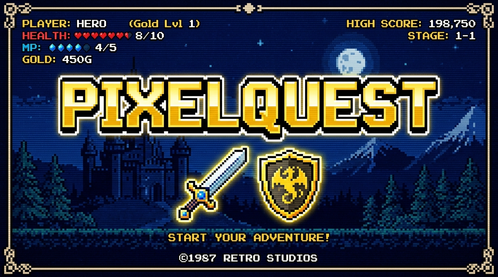

# ⚔️ PixelQuest v1.3.0 — Level Up Your Life

[](https://github.com/RAZAAli901/PixelQuest/releases/latest/download/app-release.apk)
[](https://github.com/RAZAAli901/PixelQuest/releases)
[](https://github.com/RAZAAli901/PixelQuest/releases/tag/v1.3.0)
[](LICENSE)


**PixelQuest** is a gamified daily task and habit tracker Android application built with **Kotlin** and **Jetpack Compose**. It turns real-world daily routines into engaging, rewarding RPG quests, drawn in a bold **Comic Pop** style by default, with **Retro Pixel** (8-bit arcade) and **Clean Light** themes one tap away.

---

## ⚡ Direct Download

Click the button below to directly download the latest signed release APK onto your Android device:

👉 **[📥 Direct Download app-release.apk (v1.3.0)](https://github.com/RAZAAli901/PixelQuest/releases/download/v1.3.0/app-release.apk)** 👈

Or see the release notes and files on the **[📦 v1.3.0 release page](https://github.com/RAZAAli901/PixelQuest/releases/tag/v1.3.0)**.

> **Upgrading from 1.2.0?** Install v1.3.0 over it: everything is kept.
>
> **Upgrading from 1.1.0?** From 1.2.0 on, PixelQuest is signed with a new, permanent key, so Android won't install it over 1.1.0. In the old app, open Settings → **EXPORT QUEST DATA** and save the file. Then uninstall it, install v1.3.0, and tap **I HAVE A BACKUP** on the welcome screen. Details: [docs/UPDATES_AND_BACKUPS.md](docs/UPDATES_AND_BACKUPS.md).

---

## 📥 Download & Installation Guide

### Option 1: Direct Download (Recommended)
1. Open this repository on your Android phone or tablet.
2. Tap **[Download app-release.apk (v1.3.0)](https://github.com/RAZAAli901/PixelQuest/releases/download/v1.3.0/app-release.apk)** to download the file directly.
3. Open your device's **Downloads** folder and tap `app-release.apk`.
4. If prompted, select **Allow from this source** to grant permission for sideloading unknown apps.
5. Tap **Install**, open **PixelQuest**, and begin your journey!

### Option 2: Via GitHub Releases Page
1. Visit the **[PixelQuest v1.3.0 release](https://github.com/RAZAAli901/PixelQuest/releases/tag/v1.3.0)** page.
2. Under **Assets**, click on **`app-release.apk`**.
3. Install and launch the application on your Android device.

---

## 🎮 Concept & Core Features

- **Gamified Quest Tracking**: Earn XP, level up your character class, maintain consecutive perfect day streaks, and unlock tier badges.
- **Three Themes**: **Comic Pop** (the default: ink borders, halftone panels, pop-art colours), **Retro Pixel** (8-bit arcade, with an optional CRT filter) and **Clean Light**. The COMIC MODE button on Home switches between Comic Pop and Retro Pixel.
- **Global Leaderboard**: Sign in with Google to join the opt-in leaderboard under a public name, and keep your progress synced to your account.
- **Namaz Tracker** (new in 1.3.0, optional): the five daily prayers, with their times worked out on the phone (offline), a reminder as each one starts, and a streak of days with all five.
  - Marking a prayer adds XP to the game's own: 10 a prayer, or 5 if late, and +30 for all five. At most 80 a day, plus +100 for each 7 days in a row.
  - Off until you turn it on. Your place and prayer log stay on the phone. See [docs/namaz-design.md](docs/namaz-design.md).
- **Darood Party** (new in 1.4.0, for signed-in players): small groups count Darood together, in a chat that takes only numbers.
  - Invite friends by username. Each number shows at once and arrives live for everyone. A leader can set a milestone to reach together.
  - My stats shows your total, share, place and how steady you are. An opt-in race board ranks parties by progress, showing names and progress only.
  - It never adds XP or touches the leaderboard. See [docs/darood-design.md](docs/darood-design.md).
- **Side Menu**: the three-line icon at the top left opens your profile, the Namaz Tracker, Darood Party, History, the Leaderboard, Account and Settings.
- **AI Habit Coach**: Optional short debriefs and suggestions from Google Gemini, for signed-in players, in a compact card. Task names never leave the phone.
- **Simple Mode**: A calm, un-gamified checklist whenever you want one.
- **8-Bit Sound Engine**: Built-in 8-bit sound effects (button clicks, quest completion, missed alerts, and level-up fanfares) powered by `SoundPool` with persisted volume & mute controls.
- **Character Avatar Progression**: Choose from 6 retro class sprites (*Hero, Mage, Rogue, Warrior, Paladin, Ranger*) with dynamic level tier frames (*Bronze, Silver, Gold*).
- **Retro CRT Scanline Filter**: Optional CRT scanlines and vignette for the Retro Pixel theme.
- **Interactive UI Kit**: Custom pixel-art buttons, panel cards, countdown timers, progress rings, and Press Start 2P 8-bit typography.
- **Analytics & Heatmap**: 90-day interactive activity calendar heatmap, per-task completion rate graphs, and streak history.
- **Backups That Keep Your Progress**: Export to a file, restore it on a new phone from the welcome screen, undo a restore, and daily automatic backups kept on the phone. Updates keep everything from every earlier version.

---

## 📸 Visual Showcase

| Today's Dashboard | Tasks List | Activity Heatmap | Hero Profile |
|:-----------------:|:----------:|:----------------:|:------------:|
|  |  |  |  |

The Namaz Tracker's screenshots (the side menu, a day's prayers, the XP pop-up, the all-five card, reminders and Stats) are listed in [docs/namaz-design.md](docs/namaz-design.md#screenshots), to be captured.

---

## 🛠 Tech Stack & Architecture

- **Language**: Kotlin 2.0.20 (Android SDK 34, Min SDK 24)
- **UI Framework**: Jetpack Compose (Material 3, custom Comic Pop, Retro Pixel and Light component systems)
- **Architecture**: MVVM + Clean Architecture + Reactive Kotlin Flows
- **Database & DI**: Room Database 2.6.1 + Dagger Hilt 2.51
- **Background Tasks**: WorkManager 2.9.0 + AlarmManager Exact Alarms
- **Prayer Times**: [Adhan](https://github.com/batoulapps/adhan-kotlin) 0.0.5, calculated on the phone
- **Cloud**: Supabase (Auth with Google sign-in, Postgres with row-level security, an Edge Function for the AI Coach)
- **CI/CD**: GitHub Actions building signed release APKs & publishing GitHub Releases

---

## 🔨 Build from Source

```bash
# Clone repository
git clone https://github.com/RAZAAli901/PixelQuest.git
cd PixelQuest

# Build debug APK
./gradlew assembleDebug

# Build signed release APK
./gradlew assembleRelease
```
The compiled APK will be generated at:
`app/build/outputs/apk/release/app-release.apk`

### Optional settings (`local.properties`, never committed)

To set up sign-in, the leaderboard and the AI Coach from scratch (Supabase project, email and Google sign-in, the AI server, GitHub secrets), follow [docs/CLOUD_SETUP.md](docs/CLOUD_SETUP.md).

| Setting | Used for |
| --- | --- |
| `SUPABASE_URL`, `SUPABASE_ANON_KEY` | Sign-in (by email code, and Google), cloud sync, the leaderboard and the AI Coach, which is for signed-in players. Without them the app is fully playable offline. |
| `GOOGLE_WEB_CLIENT_ID` | The Sign in with Google button (the Web client ID). Without it, players sign in by email. |
| `EMAIL_SIGN_IN` | `false` hides email-code sign-in, for a project whose emails reach only its own team. On by default; release builds turn it on only when the repository variable `EMAIL_SIGN_IN` is `true` ([docs/CLOUD_SETUP.md](docs/CLOUD_SETUP.md), step 3). |
| `GEMINI_API_KEY` | The AI Coach in **debug** builds only (still only while signed in). Release builds never contain it; they reach Gemini through the `gemini-proxy` Supabase Edge Function, which holds the key ([docs/GEMINI_PROXY.md](docs/GEMINI_PROXY.md)). Add `GEMINI_VIA_PROXY=true` to make a debug build use the proxy too. |
| `KEYSTORE_FILE`, `KEYSTORE_PASSWORD`, `KEY_ALIAS`, `KEY_PASSWORD` | Signing release builds with your own key (or set them as environment variables). Without them, release builds are signed with the debug key. |

### Tests

```bash
./gradlew testDebugUnitTest
```

```bash
node --test "supabase/functions/**/*.test.ts"
```

CI runs both on every push. Unit tests never call the live Gemini API; `GeminiConnectivitySmokeTest` makes a live call only when `PIXELQUEST_LIVE_GEMINI=1` is set.

The cloud side (database rules, email sign-in, the AI server and the app's repositories) is tested against a Supabase stack running locally in Docker: see [docs/LOCAL_SUPABASE.md](docs/LOCAL_SUPABASE.md). CI runs those tests too (`cloud-tests.yml`), and compiles the instrumented tests (`assembleDebugAndroidTest`); running them needs a device or emulator:

```bash
./gradlew connectedDebugAndroidTest
```

---

## 🛡️ Verification Status (v1.3.0)

- **Unit tests**: 1,370+ on every push, plus the cloud side (database rules, sign-in, the AI server) tested against a local Supabase stack in CI.
- **Namaz Tracker**: an end-to-end test turns it on and marks a day's five prayers on the real database: +80 XP, the all-five bonus, the streak, and the level kept. On the emulator, a real prayer reminder was posted and marked from its Prayed button.
- **Updates**: tested from every earlier version of the app's database (1 to 8), and tried on a device from v1.1.0.
- **On the emulator**: backups, restoring after a reinstall, undo, and a lost database offering its automatic backup.

Details, including what hasn't been verified yet, are in [`VERIFICATION.md`](VERIFICATION.md).

---

## 🔒 Privacy & Data Architecture

PixelQuest is built with a **local-first, privacy-respecting philosophy**:
- **Local-Only by Default**: 100% of your daily habits, scheduled times, recurrence rules, completion logs, and streak history are stored strictly on your device inside a local Room SQLite database.
- **Zero Third-Party Trackers**: No advertising SDKs, no behavioral telemetry, and no device fingerprinting.
- **Optional Cloud Leaderboard**: You can browse the community leaderboard or participate by signing in with your email (a one-time code) or Google.
  - Participation is strictly **opt-in (defaults to OFF)**, and the choice belongs to your account: your other phones follow it.
  - Only your chosen public pseudonym, player level, streak, and XP are synchronized when opted in.
  - Individual quest titles, schedules, and email addresses are **never** uploaded or exposed.
  - The Namaz Tracker's place and prayer log never leave the phone. Prayer XP joins your XP total, and only that total is synced.
  - **Fair play.** Public names are unique. The server keeps streaks and levels within what the game allows: a streak grows by at most one day a day, a level takes at least three perfect days, and both need the XP to match. Reports are limited to one per player a day.
- **Full Erasure Control**: Players can opt out at any time to instantly vanish from public rankings, or permanently purge their cloud account and data with one tap via **Settings > Cloud & Leaderboard > Delete My Cloud Data**.

For complete technical and security details, see [`PRIVACY.md`](PRIVACY.md).

---

## 📜 License
Distributed under the **MIT License**. See [`LICENSE`](LICENSE) for more details.
